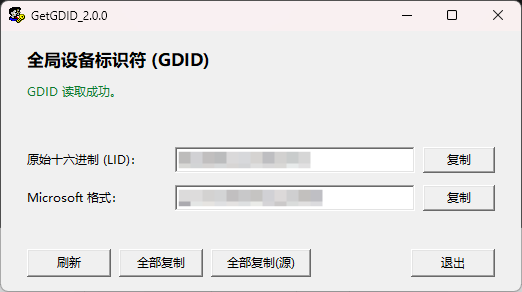

<div align="center">

<h1>GetGDID</h1>

[](#)
[](#)
[](LICENSE)

> 一键读取 **Windows 全局设备标识符（GDID / LID）**

</div>

## 📸 工具截图



## ✨ 功能说明

| 功能 | 说明 |
| --- | --- |
| 读取 LID | 显示注册表中的原始十六进制 LID |
| Microsoft 格式 | 转换为 `g:<decimal>` 格式 |

## ⚙️ 原理说明

从注册表读取 `LID` 键值，再将十六进制值转换为十进制 GDID 格式。

* **路径**：`HKEY_CURRENT_USER\SOFTWARE\Microsoft\IdentityCRL\ExtendedProperties`
* **值名**：`LID`

## ⬇️ 下载使用

[](https://github.com/NeetheCheeBao/GetGDID/releases)

## 🛠️ 本地编译

1. 克隆仓库到本地

```bash
git clone https://github.com/NeetheCheeBao/GetGDID.git
```

或者

```bash
gh repo clone NeetheCheeBao/GetGDID
```

2. 一键编译

```bat
.\build.bat
```

- 产物位置：`dist\GetGDID.exe`

## 🗂️ 项目结构

```text
GetGDID
|   .gitignore
|   app.rc              # 图标资源定义
|   build.bat           # 一键构建脚本
|   build.rs            # 构建期编译资源文件
|   Cargo.lock          # 依赖版本锁定
|   Cargo.toml          # 项目清单与依赖
|   LICENSE
|   README.md
|   version.ini         # 程序版本
|
+---assets
|       icon.ico        # 图标
|
+---screenshot
|       demo1.png       # 截图
|
\---src
        app.rs          # 窗口、控件与布局
        consts.rs       # 常量定义
        gdid.rs         # 注册表读取与 LID 解析
        main.rs         # 程序入口与消息循环
        version.rs      # 版本号解析
        win32.rs        # Win32 API 封装
```

## ⚖️ 许可证

本项目采用 MIT 许可证 - 详情请参阅 [LICENSE](LICENSE) 文件。
